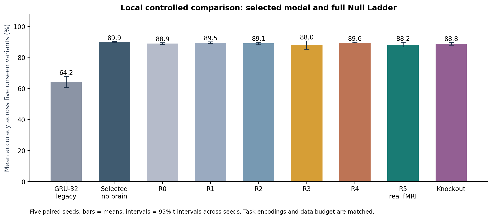
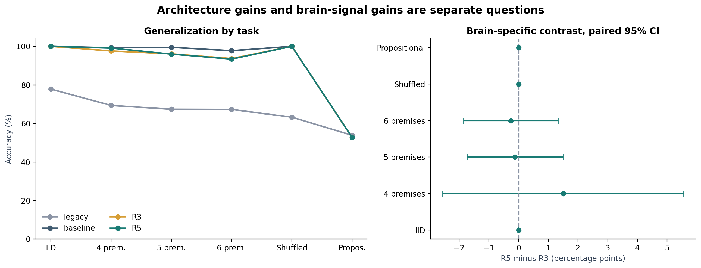
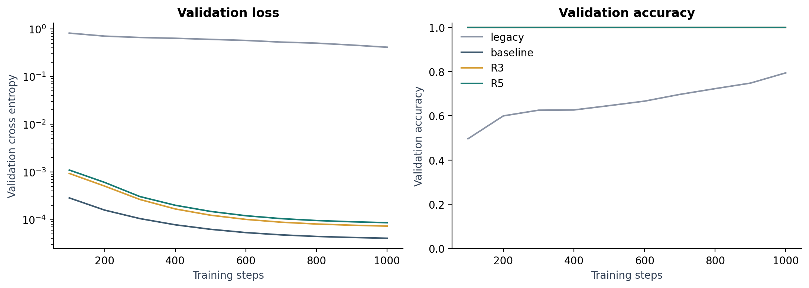
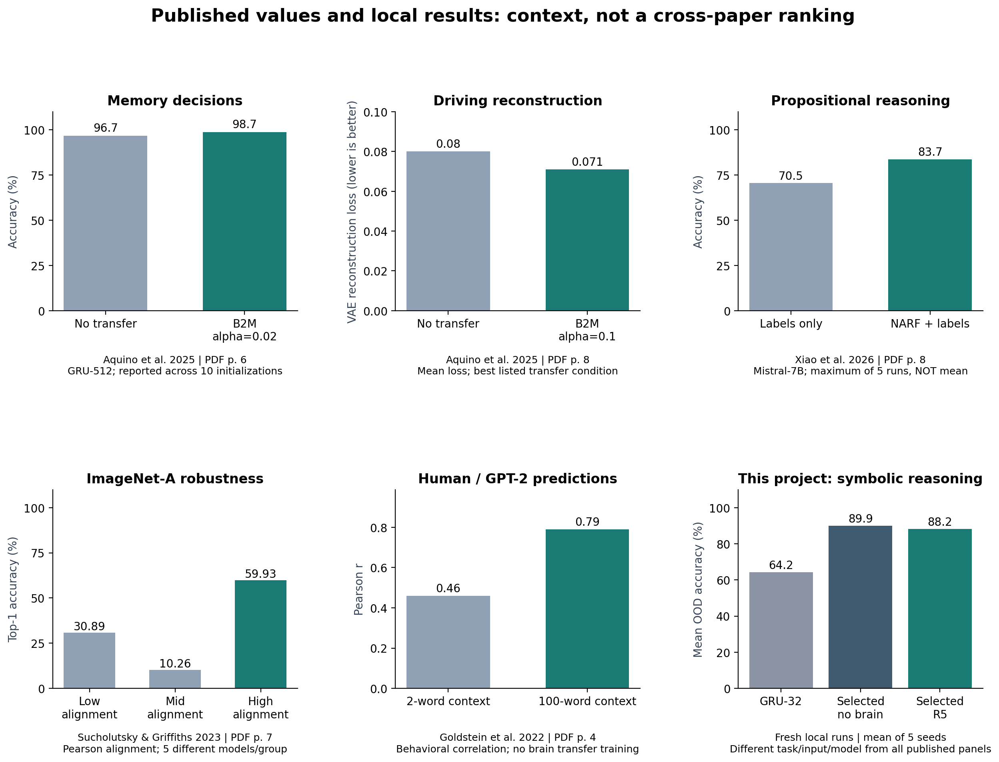
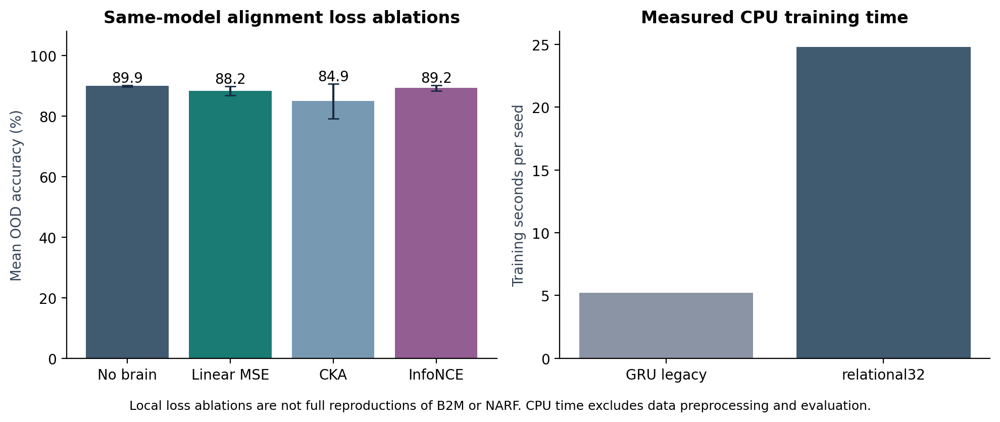
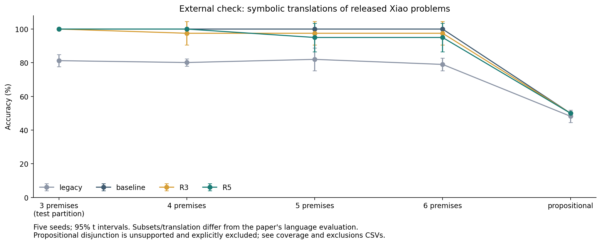

# Laptop experiment results

Fresh experiments; five final training seeds. These results do not establish superiority over the uploaded papers.

Selected model: **relational32**, **26,498 trainable parameters**. Selection used two development seeds and IID validation cross entropy only.

## Local results

| Condition | Mean unseen-task accuracy | 95% t interval across seeds |
|---|---:|---:|
| legacy | 64.25% | [60.60, 67.89]% |
| baseline | 89.86% | [89.53, 90.18]% |
| R0 | 88.94% | [88.33, 89.55]% |
| R1 | 89.50% | [88.92, 90.08]% |
| R2 | 89.05% | [88.24, 89.87]% |
| R3 | 88.02% | [85.29, 90.74]% |
| R4 | 89.58% | [89.31, 89.84]% |
| R5 | 88.24% | [86.71, 89.77]% |
| knockout | 88.80% | [87.94, 89.66]% |
| cka | 84.90% | [79.11, 90.68]% |
| infonce | 89.23% | [88.31, 90.16]% |

Selected-model baseline versus GRU legacy: **+25.61 percentage points** on the same fresh evaluation sets.
Real fMRI R5 minus matched surrogate R3: **+0.22 points**, 95% CI [-1.14, +1.59].

The relational architecture uses learned typed graph messages, shared entity weights, and query-conditioned answer prediction. It does not invoke the logic checker at inference. Its premise-order and entity-name invariance is an architectural prior. Improvement over a sequential GRU cannot be attributed to brain data.





## Protocol and limits

- Training: 1,000 steps, batch size 64 plus the same 70 brain-recorded examples, CPU, at most two workers. Training labels and examples are matched across local arms.
- New optimizer: AdamW, gradient clipping, cosine decay, validation checkpointing. Alignment weight is fixed at 0.2 with 100-step warmup for every transfer arm. GRU legacy uses Adam and its final iterate at the same step budget, on the new split; it is a retrained comparator, not the historical CSV run.
- The architecture comparison matches data and update count, not parameter count or floating-point operations. It changes both the student and training recipe; it is a combined pipeline improvement, not an isolated optimizer ablation.
- Fixed hash partitions prevent exact encoded problems crossing train/validation/test. Recorded examples are removed from validation and test. This is exact-input separation, not a claim that underlying logical templates are disjoint.
- Only three-premise syllogistic/transitive inputs are trained. Premise shuffling, longer chains, and propositional statement types remain untrained. The graph uses four learned message rounds, so length extrapolation has a structural limit.
- Propositional evaluation exhausts the test partition of a small 360-encoding space. It shares four logical templates; a high score would not demonstrate general natural-language reasoning. Other variants each use 1,000 encoded problems.
- Uncertainty intervals measure training-seed variability, not uncertainty over human subjects or task templates. Paired sign-flip p-values and Holm correction are in paired_comparisons.json. Five seeds are exploratory, with limited test resolution.
- Brain targets are fitted only to recorded training stimuli. Group fMRI representations use all ten subjects; there is no held-out-subject generalization claim. Near-ceiling accuracy can hide transfer effects. This run does not revalidate planted/hollow controls for the new architecture or replace the deck's full Phase A/RQ1/RQ2/RQ3 protocol.
- R3 is a finite-sample surrogate of retained second-order statistics. R5-R3 is an operational contrast, not proof that every surviving difference is computational structure. Mediation and knockout analyses need additional causal assumptions.
- Spectral surrogates act on ordered trial betas, not continuous raw BOLD time series; their spectra are trial-order statistics. This distinction matters when interpreting preserved physiology.

## Data and resources

All 162 manifest entries passed SHA-256 checks: 23,579,110 bytes. ds003076 has 10 subjects, 70 valid problems and three networks. HCP has 20 downloaded subjects, of which 19 belong to two matched stimulus groups. Raw BOLD, ImageNet, podcast ECoG and private patient recordings are unnecessary for this compact experiment, but would be needed for their respective full replications.
Measured maximum process working set across final jobs: 499 MB. This is a per-process measurement, not whole-system RAM. Each worker uses one CPU thread. Model tensors contain about 104 KiB in float32; checkpoints also include metadata.

## Published benchmarks




The plots transcribe numeric values from the supplied PDFs. Page numbers are physical PDF pages. Source titles, model, dataset, statistic and links are recorded in published_benchmarks.csv. Missing paper error bars are not invented. Xiao's 83.7% and 70.5% are maxima over five runs, not means. Goldstein reports correspondence, and Sucholutsky compares existing models observationally; neither is a directly comparable brain-teacher training baseline.

B2M-style InfoNCE and CKA are local objective ablations only. NARF uses a different intervention/fine-tuning pipeline; this experiment does not reproduce it. Published and local results differ in data, language encoding, evaluation and model scale, so do not use them for a best-method ranking.

## Checkpoints

Validation-selected deployment checkpoint: `results\laptop\evaluate\relational32_linear_mse_baseline_s20.pt` (condition `baseline`). Every final seed and arm also has its own .pt checkpoint and JSON training trace.

## Reproduce

```powershell
.\.venv\Scripts\python -m scripts.audit_data
.\.venv\Scripts\python -m scripts.run_laptop --stage select --workers 2
.\.venv\Scripts\python -m scripts.run_laptop --stage evaluate --workers 2
.\.venv\Scripts\python -m scripts.report_laptop
```

Completed jobs resume only when the protocol, source hash and data manifest match. Use a fresh --out directory after code or settings changes.

## External released-problem check



| Released set | Original items | Evaluated items | Unique symbolic inputs |
|---|---:|---:|---:|
| deductive_reasoning_data_test.json | 1600 | 163 | 160 |
| deductive_reasoning_data_test_4premises.json | 800 | 800 | 798 |
| deductive_reasoning_data_test_5premises.json | 160 | 160 | 160 |
| deductive_reasoning_data_test_6premises.json | 80 | 80 | 80 |
| deductive_reasoning_data_test_propositional.json | 600 | 400 | 244 |

| Released set | GRU legacy | Selected no brain | R3 | R5 |
|---|---:|---:|---:|---:|
| deductive_reasoning_data_test | 81.23% | 100.00% | 100.00% | 100.00% |
| deductive_reasoning_data_test_4premises | 80.12% | 100.00% | 97.50% | 100.00% |
| deductive_reasoning_data_test_5premises | 82.00% | 100.00% | 97.50% | 95.00% |
| deductive_reasoning_data_test_6premises | 79.00% | 100.00% | 97.50% | 95.00% |
| deductive_reasoning_data_test_propositional | 48.20% | 50.00% | 50.00% | 50.00% |

These are additional tests after model selection, using fixed symbolic translations of the released files. Exact three-premise encodings outside the frozen test partition are excluded to prevent possible overlap with generated training data. Longer-chain sets need no such exclusion because training uses only three premises. Unsupported disjunction and label/translation inconsistencies are listed in released_exclusions.csv. Lexical diversity collapses under symbolic translation; the original LLM task is harder and not directly comparable. This is not the full 600-item propositional benchmark from the paper.

Reproduce: `python -m scripts.evaluate_released`, then `python -m scripts.report_laptop`.