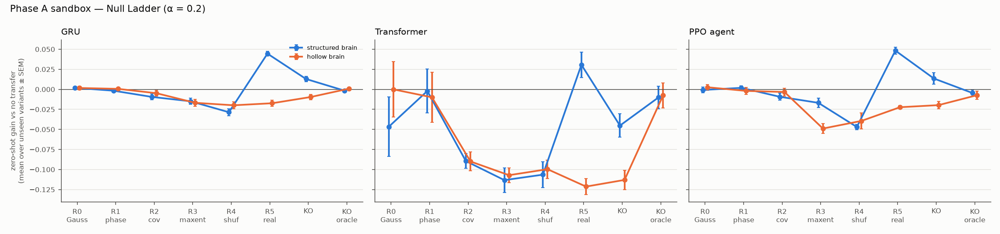
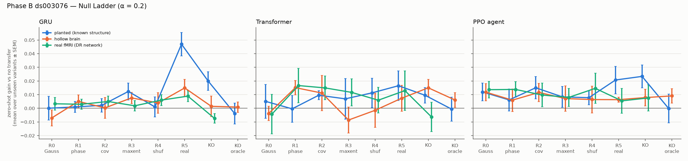
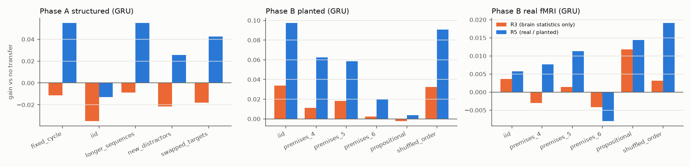
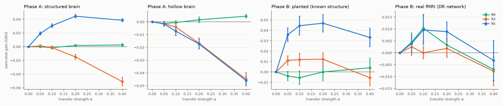
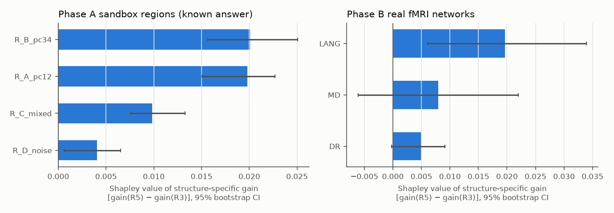
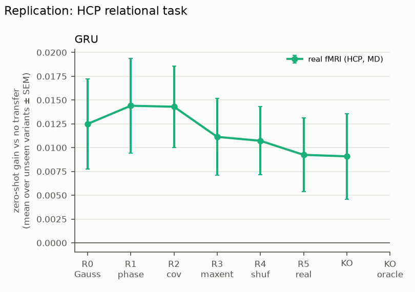

# CD-B2M results

## Summary (GRU, the student whose sandbox checks pass in both phases)

Structure-specific gain = zero-shot gain with the brain teacher (R5) minus with its max-entropy null R3, which keeps all of the brain signal's 1st/2nd-order statistics but none of its task pairing (mean, 95% CI):

| teacher signal | R5 − R3 | verdict |
|---|---|---|
| Phase A structured brain (known structure) | +0.059 [+0.053, +0.066], n = 10 | GENUINE TRANSFER |
| Phase A hollow brain (known: none) | -0.001 [-0.008, +0.007], n = 10 | REGULARIZER |
| Phase B planted (known structure) | +0.035 [+0.023, +0.046], n = 10 | GENUINE TRANSFER |
| Phase B planted at real-fMRI SNR (power check) | +0.048 [+0.042, +0.055], n = 30 | power arm (R0/R3/R5 only) |
| **ds003076 real fMRI, DR network** | +0.007 [-0.000, +0.014], n = 30 | INCONCLUSIVE |
| **HCP relational real fMRI, MD network** | -0.002 [-0.009, +0.005], n = 30 | REGULARIZER |

- The test works: it flags known structure and rejects matched-statistics noise in both phases.
- At the real data's own signal-to-noise, genuine structure would give ≈ +0.048; real deductive-reasoning fMRI gives +0.007 (upper 95% bound +0.014), i.e. at most 29% of what real structure would produce, and below the pre-set smallest effect of interest (0.02).
- HCP relational fMRI: aligning to the real brain helps exactly as much as aligning to its statistics-matched null (R5 ≈ R3 ≈ R0 ≈ +0.01): a **regularizer** effect.
- RQ1: brain-similarity mediates the gain only where structure was planted (ACME > 0); on real fMRI the mediation CI includes 0. RQ2 and RQ3: see sections 5–6.

Preset: `full` · transfer strength α = 0.2 for the ladder · every score is a **zero-shot gain**: accuracy on unseen task variants minus the paired no-transfer (α = 0) run with the same seed, data stream and evaluation sets. Ladder cells are means across seeds.

**Verdict rule** (deck slide 5: genuine transfer only if R5 beats every rung on zero-shot tests *and* the knockout falls to R3), tested inferentially across seeds:

- **GENUINE TRANSFER**: R5 > each of R0–R4 (one-sided paired t-tests, Holm-corrected, α = 0.05) **and** the knockout is significantly below R5 **and** no more than one SESOI above R3 (one-sided test).
- **REGULARIZER**: R5 is not significantly above R3 **and** TOST-equivalent to R3 within ± SESOI.
- **INCONCLUSIVE**: neither; **TRANSFER (knockout incomplete)**: clause 1 only.
- SESOI (smallest effect of interest): Phase A 0.05 (= the pre-registered margin in `configs/phaseA_thresholds.yaml`), Phase B 0.02 (≈ half the planted brain's structure-specific gain; fixed from the controls, not from real data).

The *pre-reg rule* column applies the scaffold's original mean-based thresholds (R5 mean above every rung, d(R5−R4) > 0.2, ±0.05 TOST margins). It passes the Phase A sandbox but **fails the Phase B sandbox check**: it flags the task-free *hollow* control as genuine transfer, because Phase B effects (~0.01–0.05) are far below its 0.05 margins and mean ordering alone is noise-driven. That failure is why the headline verdicts use the inferential rule; both are shown.

**An instrument is only trusted where its sandbox check passes** (structured/planted → GENUINE TRANSFER, hollow → not transfer).

## 1. Phase A — synthetic brain sandbox (known answer)

| student | arm | R0 | R1 | R2 | R3 | R4 | R5 | knockout | KO_oracle | seeds | p(R5>R3) | KO closes gap | verdict | pre-reg rule |
|---|---|---|---|---|---|---|---|---|---|---|---|---|---|---|
| GRU | structured brain | +0.002 | -0.002 | -0.009 | -0.015 | -0.029 | +0.045 | +0.013 | -0.002 | 10 | 0.000 | 53% (oracle 78%) | **GENUINE TRANSFER** | GENUINE TRANSFER |
| GRU | hollow brain | +0.002 | +0.001 | -0.005 | -0.017 | -0.020 | -0.017 | -0.010 | +0.001 | 10 | 0.556 | – | **REGULARIZER** | REGULARIZER |
| Transformer | structured brain | -0.047 | -0.002 | -0.090 | -0.113 | -0.106 | +0.031 | -0.045 | -0.010 | 5 | 0.000 | 53% (oracle 28%) | **INCONCLUSIVE** | TRANSFER (knockout incomplete) |
| Transformer | hollow brain | -0.000 | -0.010 | -0.090 | -0.107 | -0.100 | -0.121 | -0.113 | -0.008 | 5 | 0.997 | – | **REGULARIZER** | REGULARIZER |
| PPO agent | structured brain | -0.001 | +0.002 | -0.009 | -0.017 | -0.047 | +0.048 | +0.014 | -0.005 | 5 | 0.000 | 53% (oracle 81%) | **TRANSFER (knockout incomplete)** | TRANSFER (knockout incomplete) |
| PPO agent | hollow brain | +0.003 | -0.002 | -0.003 | -0.049 | -0.039 | -0.022 | -0.020 | -0.007 | 5 | 0.010 | -10% (oracle -56%) | **INCONCLUSIVE** | REGULARIZER |

- **GRU**: structured flagged as transfer ✅ · hollow not flagged ✅
- **Transformer**: structured flagged as transfer ❌ · hollow not flagged ✅
- **PPO agent**: structured flagged as transfer ❌ · hollow not flagged ✅

*KO closes gap* = (R5 − knockout) / (R5 − R3): the share of the brain-specific gain that erasing the task variables removes (100% = falls exactly to R3); the oracle erases the known generative subspace exactly. When even the oracle overshoots or undershoots R3, the knockout ≈ R3 clause is limited by how that student reacts to R3 itself, not by incomplete erasure.

## 2. Phase B — real fMRI (ds003076 deductive reasoning)

Inter-subject RDM reliability (leave-one-subject-out r) — how much problem-level structure the group teacher signal can carry at all:

| signal | syllogism | transitive |
|---|---|---|
| real fMRI (DR network) | 0.035 | 0.099 |
| planted (known structure) | 0.953 | 0.957 |
| hollow brain | 0.116 | 0.170 |
| planted @ real-fMRI SNR | 0.061 | 0.074 |
| real fMRI (MD network) | 0.022 | 0.061 |
| real fMRI (LANG network) | 0.057 | 0.101 |
| HCP relational (MD), lists 1/2 | 0.346 | 0.167 |

| student | arm | R0 | R1 | R2 | R3 | R4 | R5 | knockout | KO_oracle | seeds | p(R5>R3) | KO closes gap | verdict | pre-reg rule |
|---|---|---|---|---|---|---|---|---|---|---|---|---|---|---|
| GRU | planted (known structure) | +0.000 | +0.001 | +0.002 | +0.012 | +0.001 | +0.047 | +0.020 | -0.004 | 10 | 0.000 | 78% (oracle 147%) | **GENUINE TRANSFER** | GENUINE TRANSFER |
| GRU | hollow brain | -0.007 | +0.005 | +0.000 | +0.008 | +0.004 | +0.015 | +0.001 | +0.001 | 10 | 0.082 | – | **REGULARIZER** | GENUINE TRANSFER |
| GRU | real fMRI (DR network) | +0.003 | +0.003 | +0.005 | +0.002 | +0.006 | +0.009 | -0.007 | – | 30 | 0.032 | – | **INCONCLUSIVE** | REGULARIZER |
| Transformer | planted (known structure) | +0.005 | -0.000 | +0.010 | +0.007 | +0.011 | +0.017 | +0.010 | -0.001 | 5 | 0.103 | – | **INCONCLUSIVE** | GENUINE TRANSFER |
| Transformer | hollow brain | -0.004 | +0.015 | +0.011 | -0.009 | -0.001 | +0.007 | +0.015 | +0.006 | 5 | 0.043 | -48% (oracle 8%) | **INCONCLUSIVE** | REGULARIZER |
| Transformer | real fMRI (DR network) | -0.004 | +0.017 | +0.015 | +0.012 | +0.006 | +0.013 | -0.006 | – | 5 | 0.436 | – | **REGULARIZER** | REGULARIZER |
| PPO agent | planted (known structure) | +0.012 | +0.006 | +0.015 | +0.008 | +0.008 | +0.021 | +0.023 | -0.000 | 5 | 0.050 | -21% (oracle 169%) | **INCONCLUSIVE** | GENUINE TRANSFER |
| PPO agent | hollow brain | +0.012 | +0.006 | +0.012 | +0.007 | +0.006 | +0.006 | +0.008 | +0.009 | 5 | 0.534 | – | **REGULARIZER** | REGULARIZER |
| PPO agent | real fMRI (DR network) | +0.014 | +0.014 | +0.010 | +0.008 | +0.015 | +0.005 | +0.008 | – | 5 | 0.644 | – | **REGULARIZER** | REGULARIZER |

Phase B sandbox check (planted → GENUINE TRANSFER, hollow → not transfer):

- **GRU**: planted flagged ✅ · hollow not flagged ✅
- **Transformer**: planted flagged ❌ · hollow not flagged ✅ → this student's real-data verdict is **not interpretable**
- **PPO agent**: planted flagged ❌ · hollow not flagged ✅ → this student's real-data verdict is **not interpretable**

**Follow-up seed extension (GRU).** After the 10-seed run left real-data R5−R3 neither significant nor equivalent, 20 more seeds were run for the real-data ladders, the HCP ladder and the power arm only (declared here as a sequential extension; first-10-seed results shown for comparison):

| slice | seeds | R5−R3 [95% CI] | p(R5>R3) |
|---|---|---|---|
| real fMRI (DR network) | 10 | +0.0113 [-0.0014, +0.0240] | 0.0582 |
| real fMRI (DR network) | 30 | +0.0071 [-0.0001, +0.0143] | 0.0321 |
| planted @ real-fMRI SNR | 10 | +0.0482 [+0.0351, +0.0613] | 0.0000 |
| planted @ real-fMRI SNR | 30 | +0.0485 [+0.0424, +0.0545] | 0.0000 |
| real fMRI (HCP, MD) | 10 | +0.0004 [-0.0119, +0.0126] | 0.4773 |
| real fMRI (HCP, MD) | 30 | -0.0019 [-0.0087, +0.0049] | 0.7051 |

**Power check — planted structure at the real data's SNR** (GRU, 30 seeds): R5−R3 = +0.048 (d = 2.87), R5−R0 = +0.045. Noise scale used: {'syllogism': 10.0, 'transitive': 9.0}.

## 3. Generalization fingerprints (GRU, α = 0.2)

Regularizers lift every variant a little; real structure lifts the variants that share it. `R5−R3` isolates the structure-specific part per variant.

**Phase A structured (GRU)**

| variant | R0 | R3 | R4 | R5 | knockout | R5−R3 | p(R5>R3) |
|---|---|---|---|---|---|---|---|
| fixed_cycle | +0.000 | -0.011 | -0.024 | +0.055 | +0.018 | +0.067 | 0.000 |
| iid | -0.002 | -0.035 | -0.050 | -0.013 | +0.005 | +0.022 | 0.000 |
| longer_sequences | +0.000 | -0.009 | -0.021 | +0.055 | +0.016 | +0.063 | 0.000 |
| new_distractors | +0.004 | -0.021 | -0.034 | +0.026 | +0.006 | +0.047 | 0.000 |
| swapped_targets | +0.002 | -0.018 | -0.035 | +0.043 | +0.011 | +0.061 | 0.000 |

**Phase B planted (GRU)**

| variant | R0 | R3 | R4 | R5 | knockout | R5−R3 | p(R5>R3) |
|---|---|---|---|---|---|---|---|
| iid | +0.009 | +0.034 | -0.002 | +0.097 | +0.027 | +0.064 | 0.000 |
| premises_4 | -0.002 | +0.011 | -0.010 | +0.062 | +0.023 | +0.051 | 0.000 |
| premises_5 | +0.006 | +0.018 | +0.009 | +0.058 | +0.024 | +0.040 | 0.001 |
| premises_6 | -0.006 | +0.002 | -0.010 | +0.020 | -0.001 | +0.017 | 0.036 |
| propositional | -0.001 | -0.002 | +0.010 | +0.004 | +0.020 | +0.006 | 0.271 |
| shuffled_order | +0.003 | +0.032 | +0.006 | +0.091 | +0.034 | +0.058 | 0.001 |

**Phase B real fMRI (GRU)**

| variant | R0 | R3 | R4 | R5 | knockout | R5−R3 | p(R5>R3) |
|---|---|---|---|---|---|---|---|
| iid | +0.008 | +0.004 | +0.010 | +0.006 | -0.015 | +0.002 | 0.392 |
| premises_4 | +0.002 | -0.003 | +0.004 | +0.008 | -0.016 | +0.011 | 0.042 |
| premises_5 | +0.007 | +0.001 | +0.013 | +0.011 | -0.005 | +0.010 | 0.057 |
| premises_6 | -0.003 | -0.004 | +0.001 | -0.008 | -0.013 | -0.004 | 0.796 |
| propositional | +0.003 | +0.012 | +0.001 | +0.014 | +0.008 | +0.003 | 0.325 |
| shuffled_order | +0.007 | +0.003 | +0.011 | +0.019 | -0.011 | +0.016 | 0.013 |

## 4. RQ1 — does brain-similarity *cause* better generalization?

α is the randomised dose; mediator = CKA(student, real/structured brain embedding); covariate = CKA(student, R3 surrogate); outcome = zero-shot gain. ACME = indirect effect of the dose through brain-similarity *after* controlling for similarity to the statistics-matched null (seed-clustered bootstrap 95% CI). ρ* = residual correlation an unmeasured confounder would need for ACME to vanish.

| slice | runs | dose→CKA (a) | CKA→gain (b) [95% CI] | ACME [95% CI] | direct effect ADE [95% CI] | partial r (p) | ρ* |
|---|---|---|---|---|---|---|---|
| A|structured | 50 | +0.614 | +0.152 [+0.128, +0.182] | +0.0933 [+0.0771, +0.1113] | -0.010 [-0.032, +0.008] | +0.80 (0.000) | +0.80 |
| A|hollow | 50 | +0.241 | -0.288 [-0.553, -0.080] | -0.0694 [-0.1272, -0.0194] | -0.052 [-0.106, +0.002] | -0.43 (0.002) | -0.43 |
| B|planted | 50 | +0.332 | +0.322 [+0.197, +0.518] | +0.1068 [+0.0442, +0.1528] | -0.108 [-0.177, -0.038] | +0.54 (0.000) | +0.54 |
| B|real_dr | 90 | +0.726 | +0.034 [-0.036, +0.116] | +0.0249 [-0.0261, +0.0862] | -0.033 [-0.114, +0.036] | +0.09 (0.377) | +0.09 |

## 5. RQ2 — which brain regions drive the gain?

**Phase A sandbox regions (known answer)** — exact Shapley over all coalitions; *gain* = raw transfer gain, *structure* = gain(R5) − gain(R3)

| region | Shapley (gain) [95% CI] | Shapley (structure) [95% CI] |
|---|---|---|
| R_B_pc34 | +0.0205 [+0.0180, +0.0231] | +0.0201 [+0.0156, +0.0250] |
| R_A_pc12 | +0.0128 [+0.0087, +0.0181] | +0.0198 [+0.0151, +0.0227] |
| R_C_mixed | +0.0101 [+0.0079, +0.0122] | +0.0098 [+0.0075, +0.0133] |
| R_D_noise | -0.0004 [-0.0024, +0.0016] | +0.0041 [+0.0006, +0.0065] |

**Phase B real fMRI networks** — exact Shapley over all coalitions; *gain* = raw transfer gain, *structure* = gain(R5) − gain(R3)

| region | Shapley (gain) [95% CI] | Shapley (structure) [95% CI] |
|---|---|---|
| LANG | +0.0200 [+0.0085, +0.0291] | +0.0196 [+0.0061, +0.0339] |
| MD | +0.0116 [-0.0039, +0.0271] | +0.0080 [-0.0061, +0.0220] |
| DR | +0.0082 [+0.0007, +0.0158] | +0.0050 [-0.0003, +0.0091] |

## 6. RQ3 — does it hold across architectures?

| arm | GRU | Transformer | PPO agent |
|---|---|---|---|
| Phase A: structured brain | GENUINE TRANSFER | INCONCLUSIVE | TRANSFER (knockout incomplete) |
| Phase A: hollow brain | REGULARIZER | REGULARIZER | INCONCLUSIVE |
| Phase B: planted (known structure) | GENUINE TRANSFER | INCONCLUSIVE | INCONCLUSIVE |
| Phase B: hollow brain | REGULARIZER | INCONCLUSIVE | REGULARIZER |
| Phase B: real fMRI (DR network) | INCONCLUSIVE | REGULARIZER | REGULARIZER |

## 7. Replication — HCP relational processing (MD network)

| student | arm | R0 | R1 | R2 | R3 | R4 | R5 | knockout | KO_oracle | seeds | p(R5>R3) | KO closes gap | verdict | pre-reg rule |
|---|---|---|---|---|---|---|---|---|---|---|---|---|---|---|
| GRU | real fMRI (HCP, MD) | +0.012 | +0.014 | +0.014 | +0.011 | +0.011 | +0.009 | +0.009 | – | 30 | 0.705 | – | **REGULARIZER** | REGULARIZER |
